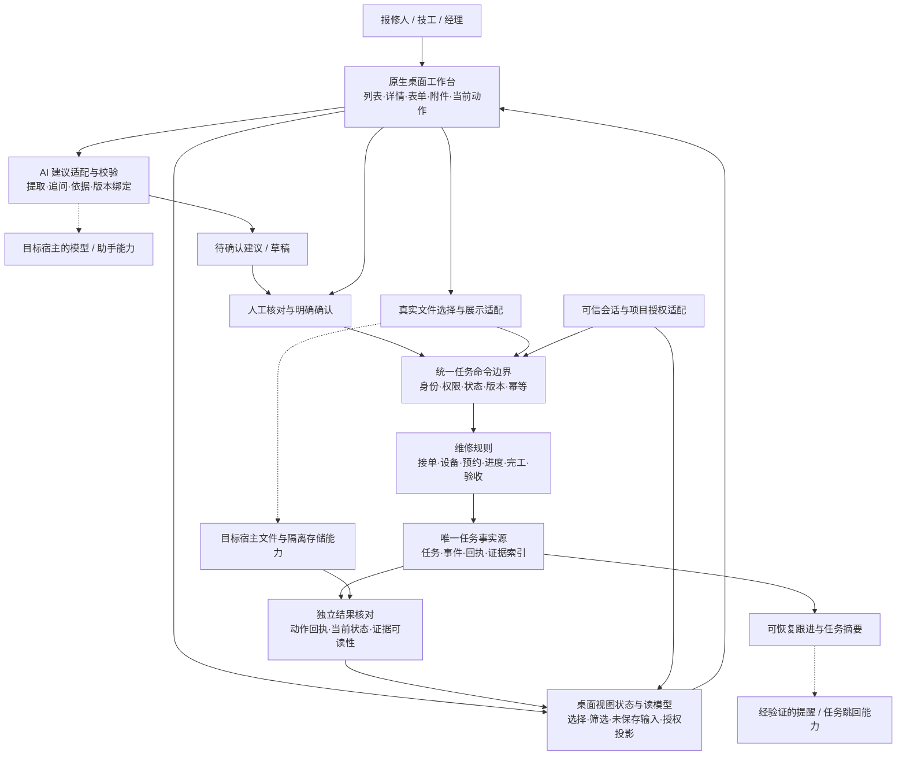

# 桌面优先的维修任务协作架构

日期：2026-10-09。性质：拟实施方案，不是已完成架构。
目标：一个原生桌面工作台、一个任务事实源、一条受确认与核验约束的维修主线。

## 1. 产品与范围

用户通过桌面应用输入报修，AI 帮助整理事实、追问缺项和解释依据；用户确认后创建真实工单。
技工经接单、设备确认与预约进入处理，提交真实说明和附件；报修人或有权限的独立主体验收。
一项任务在不同角色、重启和重试之间保留同一个 ID；完成与退回均有来源和历史。

沿用石墨 UI、现有业务状态、设备/空间规则、预约、证据与独立验收、收藏、既定跟进及三条 AI 链路。
保持一个桌面应用。先支持明确的维修场景，不扩经营大屏、新皮肤、新客户端、通用多 Agent 平台。
不删原有必需功能或验收项。旧合同、权限、源状态和外部工单边界继续有效。

## 2. 架构图

下图表达职责，不承诺宿主存在同名接口；虚线能力须 M0 核验。

“独立核对”表示重新读取权威结果，不等于一定要再调一个模型。
“独立验收”表示业务上不同的可信人员；两者都需要，不能互相代替。

## 3. 各层边界

|层|负责|不能承担|
|---|---|---|
|桌面 UI|信息层级、真实输入、确认、证据查看、错误恢复|直接写最终业务状态、把隐藏按钮当授权|
|视图状态 / 读模型|task_id 选择、筛选、未保存表单、主体可见投影|成为第二个工单数据库|
|AI 建议|原文提取、设备/历史依据、阶段说明、缺项提醒|创造设备事实、自行审批、认定维修已完成|
|命令边界|可信身份、权限、源状态、expected_version、稳定动作键|依赖模型自律或客户端自报角色|
|领域规则|设备服务关系、预约冲突、有效状态迁移、轮次、终态限制|因界面方便或演示需要改低门槛|
|存储与证据适配|一致提交、恢复、附件字节与索引、读回|把四次 fs.write 称作事务，把 ready 布尔值当文件证明|
|核验与跟进|查询原动作、检查证据、提醒去重、独立人员验收入口|把通知发出或模型回复当任务完成|

架构按职责分层，不拆微服务。是否拆脚本文件取决于宿主真实模块/构建能力，不发明 import 或平台服务。
旧 Python 领域核心保留为规则与回归参考；不假设它已运行在原生包中。
若需要包外服务，先由 M0 给出身份、数据流、部署和比赛运行方式的可审阅方案，再按用户决策实施。

## 4. 桌面工作台的具体设计

沿用 [桌面 v2](../../../design-references/2026-10-08-desktop-v2/DESIGN_SPEC.md)，接纳本地已有修改。

|区域|用户应看到什么|交互要求|
|---|---|---|
|应用头部|当前项目、可信身份、应用级入口|不重复画系统标题栏；真实连接状态才显示在线|
|左侧导航|我的任务、待我处理、收藏、设置|视角切换不增加权限；调试角色切换不进入正式主流程|
|任务列表|问题摘要、空间、阶段、负责人、待办提示|搜索/筛选有真实结果；选中稳定 task_id，不靠数组下标|
|中心详情|问题原文、空间/设备、预约、处理记录、附件|不同阶段突出当前事实；历史可查|
|当前行动区|一个主要动作、必要次动作、不能操作的原因|提交中防重复；失败保留输入；待核验与成功分开|
|表单 / 面板|报修草稿、预约、处置、完工、验收和退回原因|真实输入、键盘焦点、未保存提示、错误同屏|
|AI 建议区域|来源、依据、缺项、版本/过期状态及采纳入口|与已执行事实区分；采纳后仍按业务要求确认|
|证据区域|本轮文件、可读状态、打开/预览、失败/隔离原因|真实字节和当前访问权限，不能只展示一张静态占位图|

首屏问题：哪里坏了、现在到哪一步、谁在处理、我下一步能做什么。
报修人关注确认与验收；技工关注可接任务和处置；经理关注分配、冲突和合规代处理。
待验收首屏优先显示本轮维修结果和证据；旧预约缩成摘要。
退回重做展示轮次与原因，保留历史证据。

原生尺寸目标：1440×900、1280×800、980×760，150% 文字放大；更窄时列表/详情分级。
操作区可移到详情下方，不强行固定四栏挤压内容。保存选中、筛选和必要滚动位置。
检查长中文、空态、无权限、无模型、附件失败、确认过期、保存待核验与键盘流程。
尺寸、颜色和视觉规格是设计目标；必须用真实桌面截图及交互核验。

## 5. 核心概念与协议

以下是本项目拟定的内部语义，非官方宿主 API；实施时沿用既有命名并显式版本化新增协议。

- Task：稳定 task_id、业务 version、当前状态、角色关系与时间信息。
- Proposal：proposal_id、请求标识、输入版本、任务/草稿版本、事实/证据版本、建议内容、缺项、依据、到期与状态。
- Command：动作类型、对象、预期版本、确认过的规范化参数、稳定 action_key；主体由可信会话核验。
- Receipt：稳定 action_id、命令指纹、对象、提交前后版本、结果及恢复查询所需信息。
- Evidence：真实文件引用、字节数、摘要、可读状态、任务归属、上传主体、完工轮次/证据集合版本。
- Acceptance：验收主体、权限依据、completion_id/轮次、所引用证据集合、意见与时间。

一次用户意图生成一个稳定动作键；重试沿用，同键不同参数拒绝。
人工确认绑定具体内容；编辑、改派、改约、补证据或撤权后重新检查有效性。
AI 回包和用户采纳两处校验，避免迟到回复覆盖当前输入。
指纹算法、schema 校验和文件摘要采用宿主实际支持的实现，不假设字符串存在 hash 方法。

## 6. 可靠性与三层核验

1. 保存核验：业务提交后查权威动作回执，核对任务 ID、版本、状态及一致结果。
2. 证据核验：确认真实字节能读、摘要/类型/大小合法、任务和轮次匹配、访问权有效。
3. 业务验收：独立可信人员确认问题已解决，或带理由退回。AI 整理材料不能代替该决定。

UI 执行状态与业务状态分开：提交中、已提交待核验、核验成功、明确失败、需要重新确认。
结果未知时优先对账，不能盲目再执行；任务后来升级版本时，用历史回执认定原动作，再展示最新状态。
任务/预约/回执/事件必须满足既有一致性目标。追加日志、快照或其他提交协议只是假设候选，M0/M2 需验证平台原语、并发和崩溃恢复；若达不到要求就 BLOCKED。

附件在完工提交及最终验收时重新检查，避免上传时 READY 而验收前已损坏。
合法测试夹具可用于失败注入，但端到端成功链不得手工更改工单状态或伪造证据。

## 7. 模块与验收范围

- **M0 桌面运行基线与能力裁决**：确认这份桌面应用准备在哪个宿主版本运行，以及模型、文件、身份和存储是否有可实施路径。
- **M1 原生桌面框架与交互基线**：交付真正可操作、层级清楚的桌面工作台，让后续业务都在同一个界面上增长。
- **M2 可信身份与可靠任务执行**：一次用户操作只能被正确执行一次，结果未知可对账，失败和重启不会制造假成功。
- **M3 真实输入与AI报修**：从用户实际描述得到可编辑、有来源的报修草稿，经人确认后创建可回读工单。
- **M4 接单设备与预约桌面流程**：把既有业务规则接成桌面上可理解、可填写、可确认的一段真实处理流程。
- **M5 真实附件完工与独立验收**：让真实证据支持完工，并由独立可信主体完成验收或退回重做。
- **M6 桌面体验收口与持续跟进**：让桌面应用能持续使用，并补齐既有 P0 中尚未覆盖的跟进与 AI 场景。
- **M7 同版本总验收与发布准备**：拿出可复现、材料一致的桌面发布候选；明确本地验收、发布、赛事提交和收录的不同状态。

每模块包括对应桌面变化、领域/适配改动、相关失败场景和证据。
M1 的框架通过不代表 M3/M5 业务通过；后续新增表单必须再次检查其布局、键盘、错误和恢复。
M7 重跑全量原要求，模块 PASS 不能代替最终同版本验收。

## 8. 可继承与必须重新证明

继承：业务状态与守卫设计、旧领域规则/测试资产、石墨视觉、桌面 v2 信息结构、既有候选的可追溯版本。
重验：当前原生宿主行为、模型运行、可信身份、稳定幂等、存储一致性、真实附件、完整闭环及最终材料。
本地新增视图出现重复同名辅助函数等风险，先在 M0/M1 确认实际解析与调用影响，不凭静态怀疑宣布运行故障。

参考：[官方初评口径](https://create.gosim.org/agenticapp26/#results)、[我们评语](https://github.com/OctoSense-org/OctoSense-App-Hub/issues/149#issuecomment-6077998311)、[TraceShop](https://github.com/OctoSense-org/OctoSense-App-Hub/issues/71#issuecomment-6077956506)、[行程天气](https://github.com/OctoSense-org/OctoSense-App-Hub/issues/109#issuecomment-6077985785)。
评分只能说明初评结果，本方案不承诺分数提升或赛事录取。

